## Entiteter och Atribut:

- Avdelning: namn, kontorsort.
- Anställd: förnamn, efternamn, unik mail, anställningsdatum.
- Passerkort: unikt kortsnummer, utfärdsdatum, sista gilltighetsdatum.
- Kompetens: unikt namn, beskrivning.

## Relationer (med UML skrift):

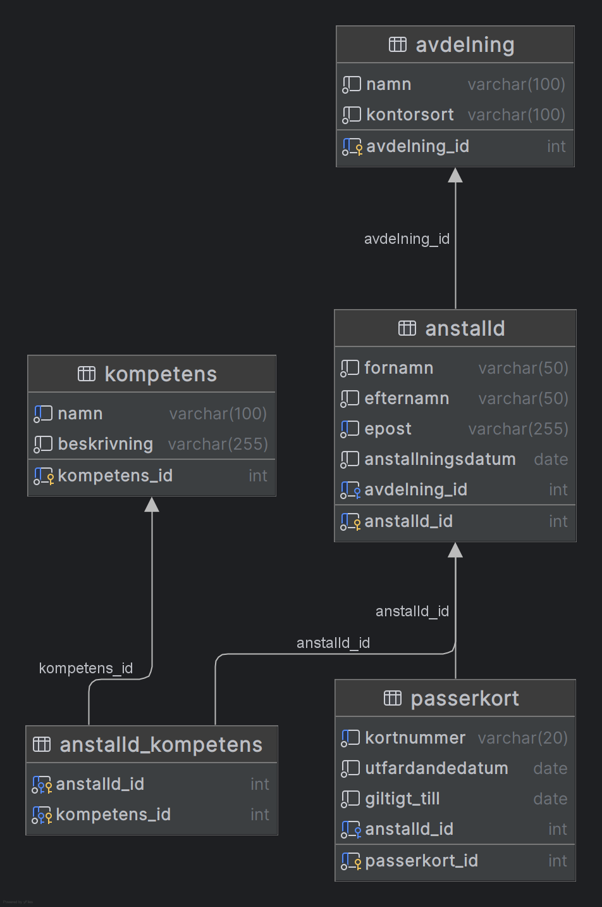
_(Dessa pilar var jobbigt att lista ut hur man gör i detta)_

- Avdelning 1 → 0..* Anställd. Främmande nyckel avdelning_id i anstalld, NOT NULL eftersom en anställd måste ha en
  avdelning.
- Anställd 1 → 0..1 Passerkort. Främmande nyckel anstalld_id i passerkort, med UNIQUE så att en anställd inte kan få två
  kort. Kortet kan inte finnas utan anställd (NOT NULL).
- Anställd * ↔ * Kompetens. Det kräver en kopplingstabell anstalld_kompetens med sammansatt primärnyckel (anstalld_id,
  kompetens_id), vilket hindrar samma koppling två gånger.

## Bilder med korta förklaringar (förklaringar är under bilderna, vill förtydliga de):

- Var tvungen att göra om hela labben, vet inte exakt vad som hände med förra men hela databasen låste sig och var
  lättare att bara börja om och göra om stegen.

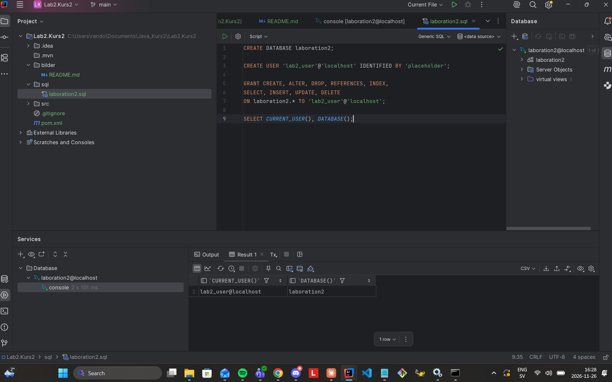

- Skapandet av min databas och user från root.

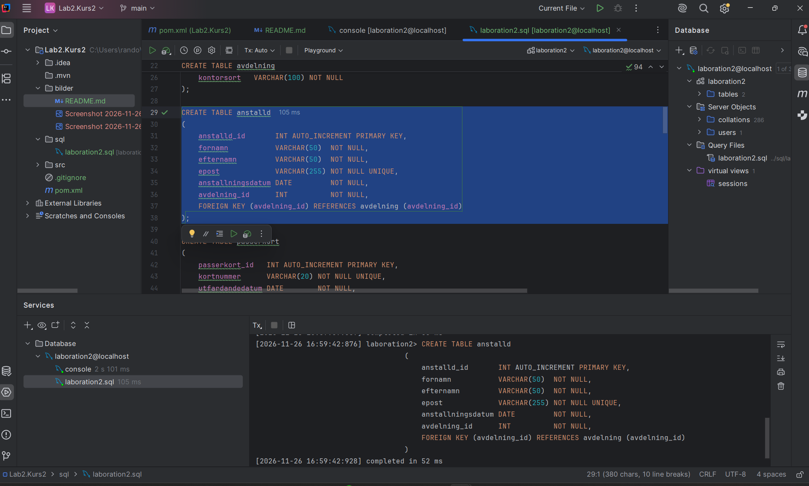

- Skapande av tabellen "anställd".

- Skapande av relationstabell för att länka flera primära nycklar.

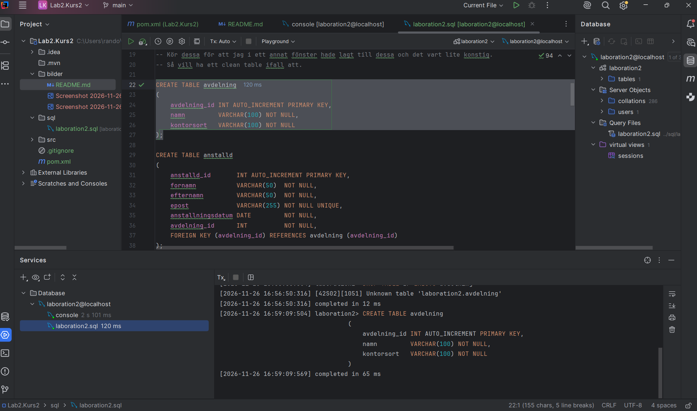

- Skapande av "avdelning" tabellen.

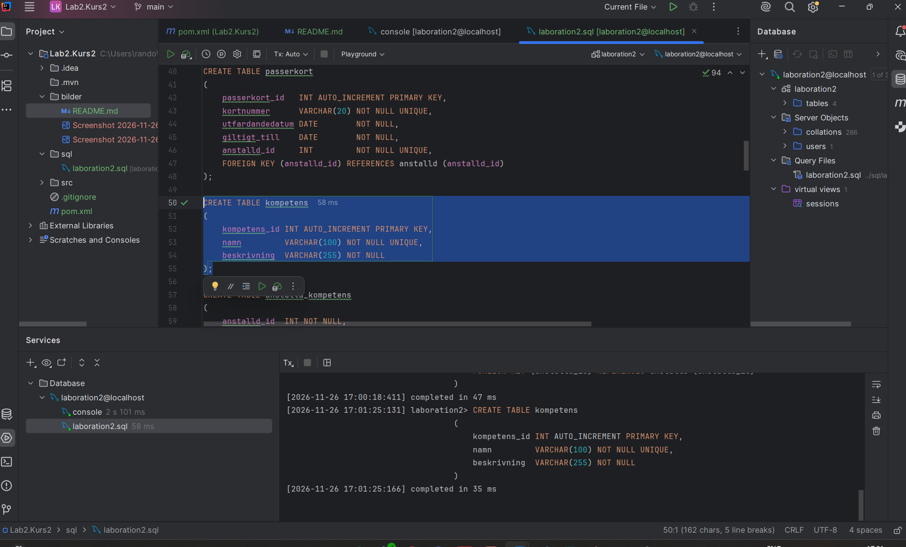

- Skapande av "kompetens" tabellen.

- Skapande av tabellen "passerkort".

- Första prompten: få fram datatabell om anställda med avdelning.

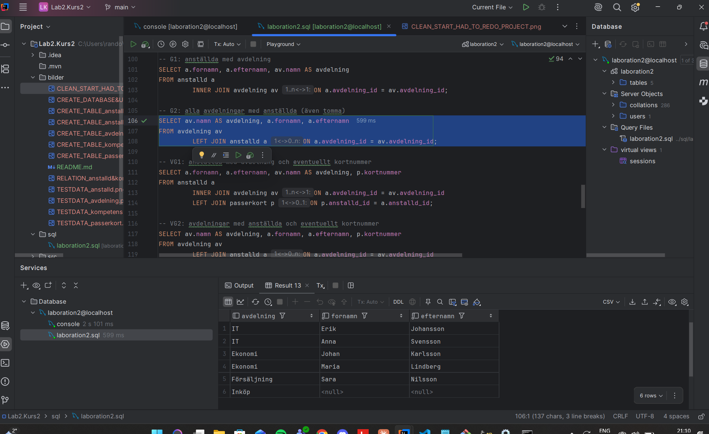

- Andra prompten: få fram datatabell om alla avdelningar med anställda (även tomma).

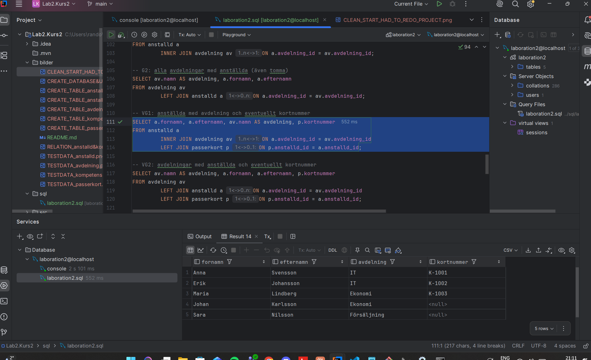

- Första VG promten: få fram datatabell om anställda med avdelning och eventuella kortnummer.

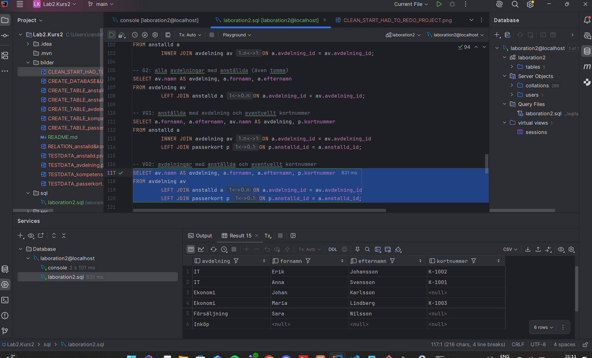

- Andra VG promten: få fram datatabell om avdelningar med anställda och eventuella kortnummer.

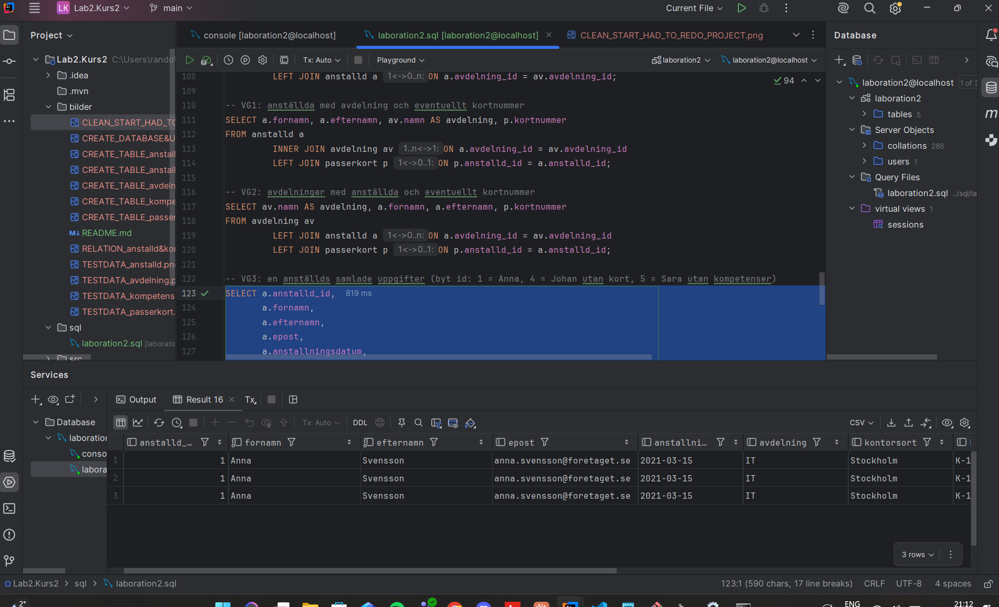
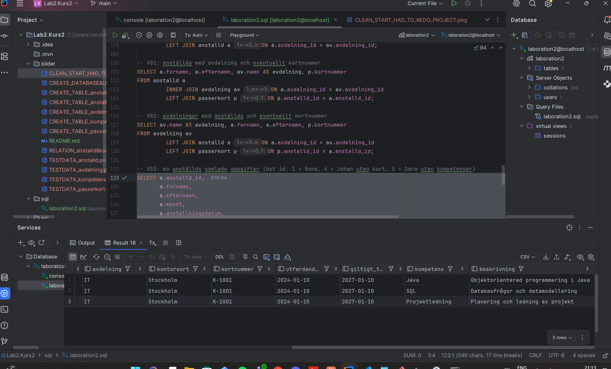
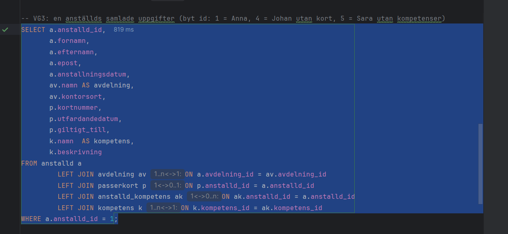

- Tredje VG prompten: få fram datatabell om en anställds samlade uppgifter.
- (byte av id: 1 = Anna (ovan, 4 = Johan utan kort (nedan 1), 5 = Sara utan kompetenser (nedan2)))
  
  

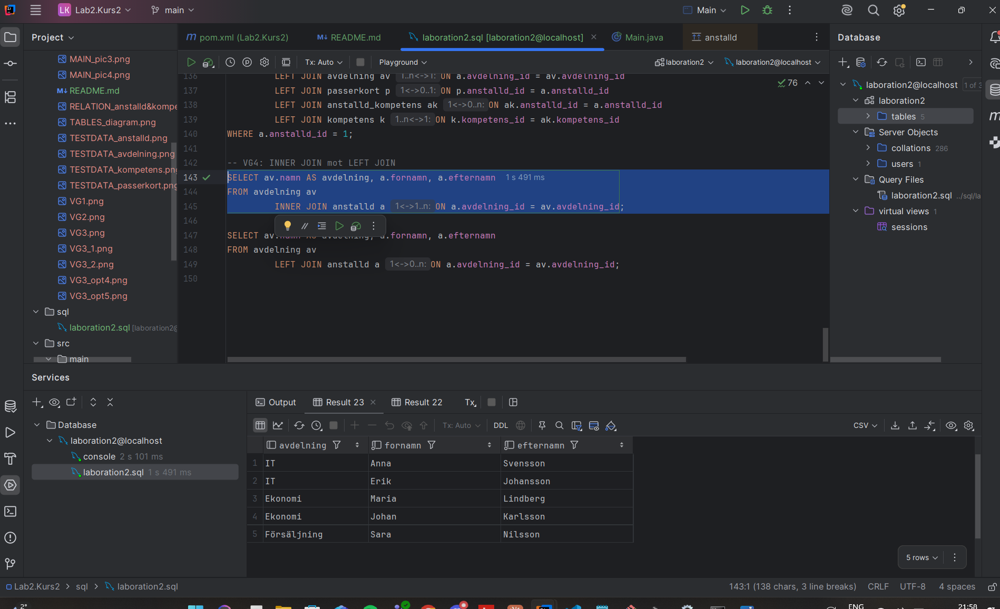

- INNER JOIN mot LEFT JOIN: Inner join hittar bara resultat som matchar, medan Left tar de som matchar samt även de med
  eventuellt null värde från den vänstra tabellen.

- Min testdata och mina SQL promts för det, bad google om diverse namn och uppgifter.

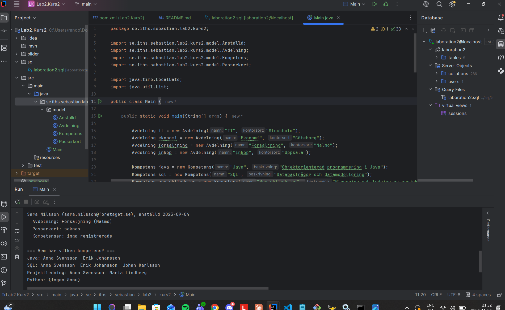

- Min körning av main och alla resultat av tillagd information och utskrift av data från tabellerna.

